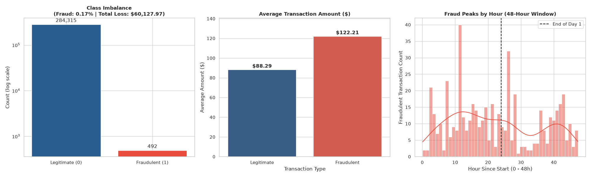
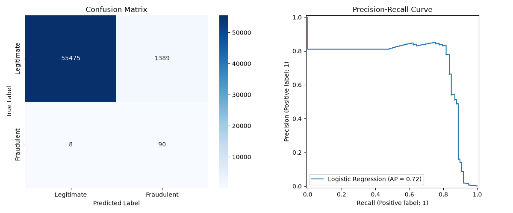
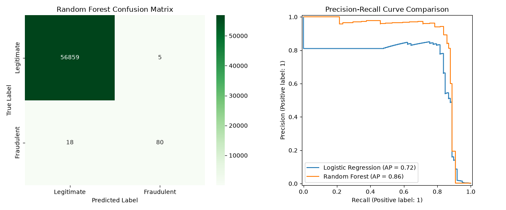
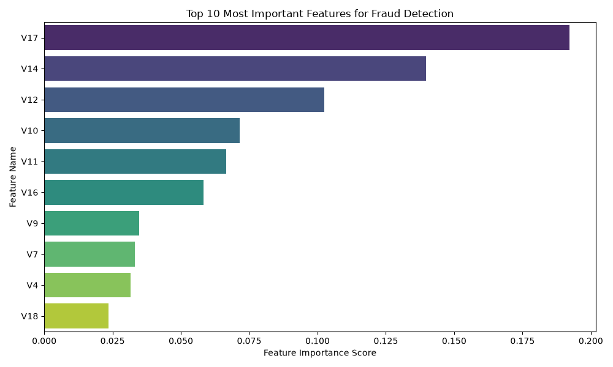

Under Development (pytest, model)

```markdown
# Credit Card Fraud Detection & Analytics Pipeline

An end-to-end Machine Learning and Analytics project designed to identify fraudulent credit card transactions within highly imbalanced financial data. This project implements a full analytical lifecycle-from exploratory data analysis (EDA) and feature scaling to model benchmarking, confusion matrix diagnostics, feature importance evaluation, and model artifact serialization for production deployment.

---

## Project Architecture

The repository is structured according to professional Analytics & ML Engineering standards:

```text
5_credit_fraud_detection/
├── data/
│   ├── processed/              # Cleaned and processed datasets
│   └── raw/
│       └── creditcard.csv      # Raw transaction dataset (284,807 records)
├── docs/                       # Visualizations & analytical reports
│   ├── 8_confusion_matrix_and_pr_curve.png
│   ├── 9_random_forest_confusion_matrix_and_pr_curve.png
│   ├── 10_top_10_feature_importance.png
│   └── fraud_analysis_charts.png
├── models/                     # Serialized production model artifacts
│   ├── random_forest_fraud_model.joblib
│   └── scaler.joblib
├── notebook/                   # Interactive Jupyter notebooks
│   ├── 01_Data_Preparation_and_EDA.ipynb
│   └── 02_Model_Development.ipynb
├── src/                        # Modular source code
│   ├── analysis.py
│   └── model_development.py
├── tests/                      # Automated unit testing suite
│   └── test_analysis.py
├── .gitignore                  # Git tracking exclusions (heavy data/models)
├── README.md                   # Project documentation
└── requirements.txt            # Environment dependencies

```

---

## Key Findings & Business Insights (EDA)

The analysis evaluates 284,807 transactions from European cardholders (48-hour observation window):

* **Extreme Class Imbalance**: Fraudulent transactions account for only **0.172%** of total activity (492 fraud cases vs. 284,315 legitimate transactions).
* **Direct Financial Loss**: Total direct losses from fraudulent operations equal **$60,127.97**.
* **Transaction Amount Variance**: The average fraudulent transaction value is **$122.21**, compared to **$88.29** for legitimate operations.
* **Temporal Clustering**: Fraudulent activity exhibits pronounced temporal peaks during off-peak night/early-morning hours, reflecting automated batch testing when cardholder response to push notifications is slowest.

### EDA Visualizations

---

## Feature Engineering & Pipeline

1. **Feature Scaling**: Scaled raw `Amount` and `Time` features using `StandardScaler` to match the scale of anonymized PCA components (`V1`–`V28`).
2. **Column Dropping**: Removed original unscaled `Amount` and `Time` columns to eliminate redundancy.
3. **Stratified Train-Test Split**: Implemented an 80/20 train-test split (`test_size=0.2`, `random_state=42`) with `stratify=y` to preserve the 0.17% fraud ratio in both sets (Test size: 56,962 transactions; 98 fraud cases).

---

## Model Performance & Evaluation Benchmark

To resolve extreme class imbalance, standard `Accuracy` was bypassed in favor of **Precision**, **Recall**, **F1-Score**, **ROC-AUC**, and **Average Precision (AP)**.

### Benchmark Comparison

| Metric | Baseline: Logistic Regression | Optimized: Random Forest Classifier | Business Impact |
| --- | --- | --- | --- |
| **Precision (Fraud)** | **0.06 (6%)** | **0.94 (94%)** | **False alarms reduced by 99.6%** (from 1,389 down to 5). |
| **Recall (Fraud)** | **0.92 (92%)** | **0.82 (82%)** | Successfully catches 80 out of 98 fraud cases in test set. |
| **F1-Score (Fraud)** | **0.11** | **0.87** | Nearly 8x improvement in overall classification quality. |
| **ROC-AUC Score** | **0.9722** | **0.9528** | Strong class separability across confidence thresholds. |
| **Average Precision (AP)** | **0.72** | **0.86** | Superior Precision-Recall trade-off curve. |
| **False Positives (FP)** | **1,389** | **5** | Eliminates customer friction and support overload. |
---

### 🔍 Diagnostic Visualizations & Confusion Matrices




---

## Feature Importance Analysis

Extracting Gini importance scores from the Random Forest model revealed the key underlying drivers of fraud detection:

1. **`V17`** (Weight: **>0.19**) - Primary predictor
2. **`V14`** (Weight: **~0.14**) - Secondary predictor
3. **`V12`** (Weight: **~0.10**) - Tertiary predictor
4. `V10`, `V11`, `V16` - High impact indicators

> **Business Takeaway**: Hidden behavioral patterns captured within the anonymized PCA components (`V17`, `V14`, `V12`) hold significantly higher predictive power than raw transaction `Amount` or `Time`.

### Top-10 Features Visualization

---

## Production Artifacts

Model and scaler objects are serialized via `joblib` into the `models/` directory for deployment into downstream microservices or REST APIs (e.g., FastAPI):

* `models/random_forest_fraud_model.joblib`: Trained Random Forest classifier.
* `models/scaler.joblib`: Fitted `StandardScaler` instance for input preprocessing.

---

## 🚀 Getting Started & Execution

### 1. Environment Setup

```bash
# Clone the repository
git clone [https://github.com/diyorIsamukhamedov/credit_card_fraud_detection.git]
cd credit_fraud_detection

# Create and activate virtual environment
python3 -m venv venv
source venv/bin/activate  # On Windows: venv\Scripts\activate

# Install dependencies
pip3 install -r requirements.txt

```

### 2. Running Analysis & Model Training

```bash
# Run standalone model development script
python3 src/model_development.py

```

### 3. Running Unit Tests

```bash
# Run pytest verification suite
pytest tests/ -v

```

---

## Tech Stack

* **Language**: Python 3.12+
* **Data Processing**: `pandas`, `numpy`
* **Machine Learning**: `scikit-learn`, `joblib`
* **Visualization**: `matplotlib`, `seaborn`
* **Testing & Quality**: `pytest`